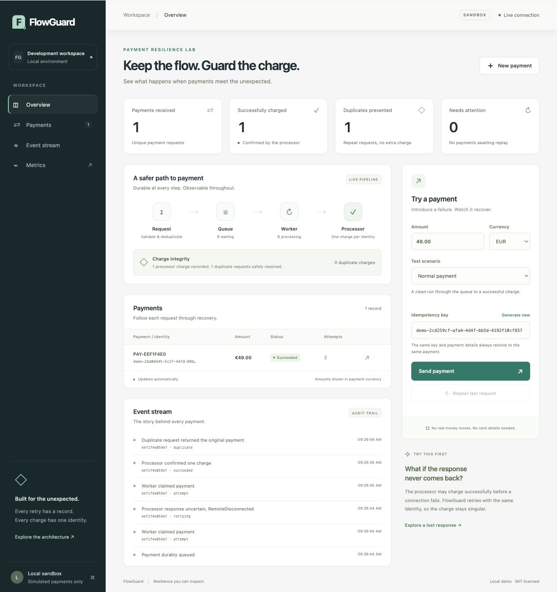

# FlowGuard

A payment resilience lab. Send duplicate requests, inject failures, and inspect how a durable queue recovers without a second simulated charge.

FlowGuard uses Python's standard library and SQLite. The API, worker, and simulated payment processor run as separate processes. No real money or card data enters the system.



## Run locally

Requires Python 3.11 or newer. Start these commands in separate terminals from the repository root.

```sh
python3 -m flowguard processor
python3 -m flowguard worker
python3 -m flowguard api
```

Open http://localhost:8080. Keep the same idempotency key when retrying the same payment. Use a new key for a new payment.

## Run with containers

```sh
docker compose up --build
```

Enable Prometheus at http://localhost:9090.

```sh
docker compose --profile monitoring up --build
```

Named volumes preserve the queue and processor ledger across restarts. `docker compose down` stops services and preserves volumes.

## Verify behavior

```sh
python3 -m unittest discover -s tests -v
python3 scripts/smoke.py
```

The smoke check starts an isolated API, worker, and processor, sends concurrent requests, injects a lost response, restarts the worker, and checks the processor ledger.

## Why a database queue

Payment creation and job creation share a transaction. An external broker would need an outbox relay to preserve that property. SQLite makes the demo reproducible without external dependencies. A production system with multiple hosts would use a shared transactional database and an outbox or a database queue.

The worker delivers at least once. The processor stores a unique idempotency key with the charge. A worker crash after charging can cause another delivery, but the processor returns the existing charge. This guarantee depends on retaining both databases and reusing the same key.

See [the implementation plan](docs/plan.md) and [the architecture review](docs/architecture-review.md).

## Failure scenarios

- Normal completes on the first attempt.
- Transient fails twice, then succeeds.
- Lost response commits the charge, drops the connection, and succeeds on retry with the same charge.
- Declined is terminal and does not retry.
- Outage always returns unavailable. It reaches dead letter. Replaying preserves identity but repeats this permanent injected fault.

To test recovery from a real temporary service failure, stop the processor, submit a normal payment, and restart the processor before retries are exhausted. Replay a dead-letter normal payment after restarting the processor.

## Demo boundary

This is a local learning project. It has no authentication, tenant isolation, card handling, real provider integration, or financial reconciliation. Bind the dashboard to localhost. Do not expose it as a payment service.

MIT licensed.
